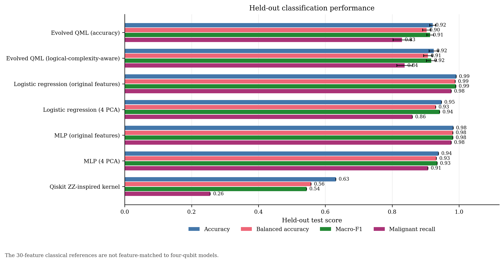
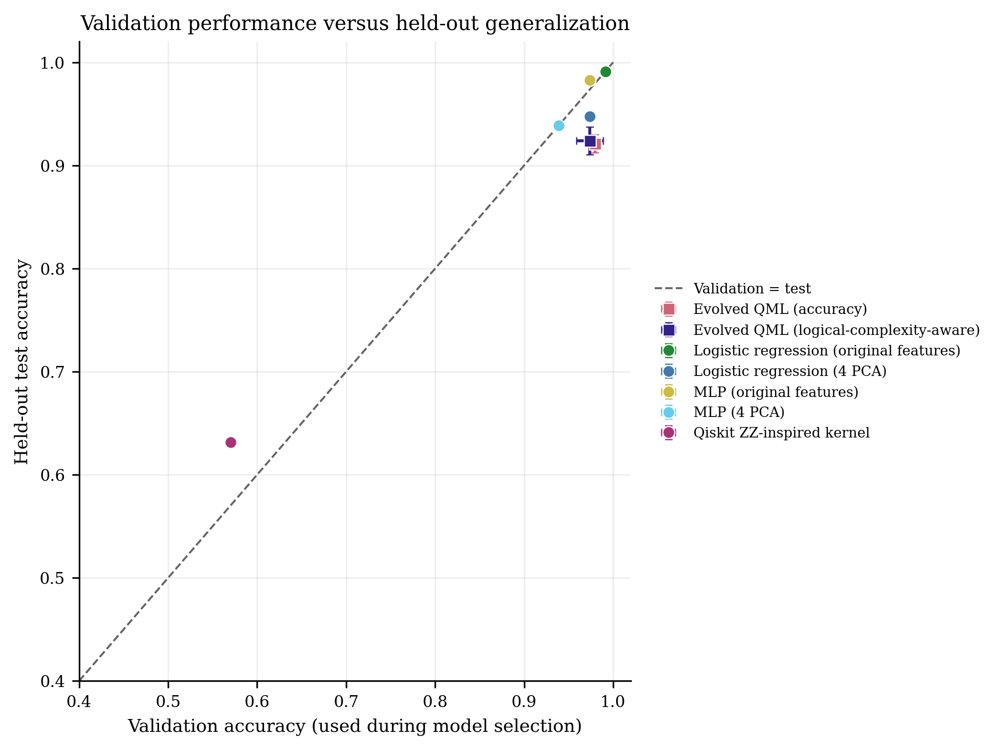
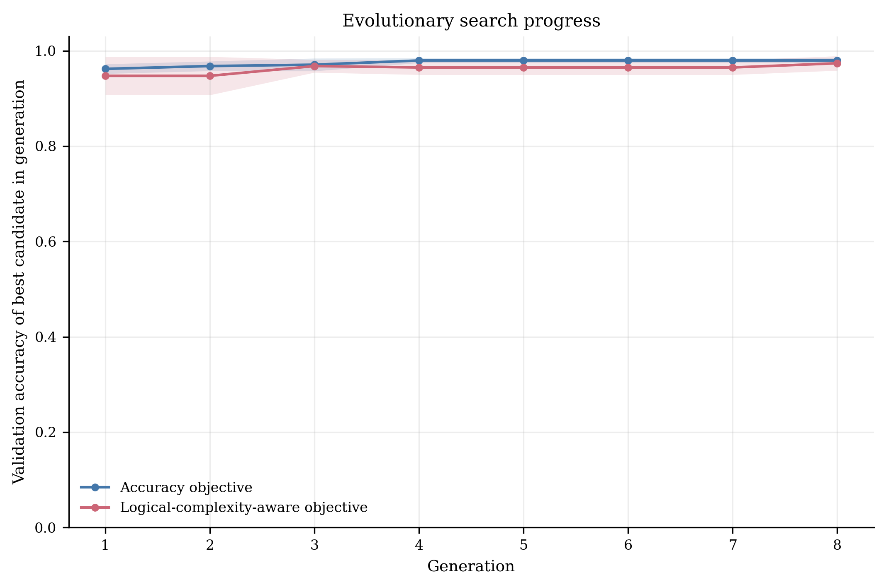
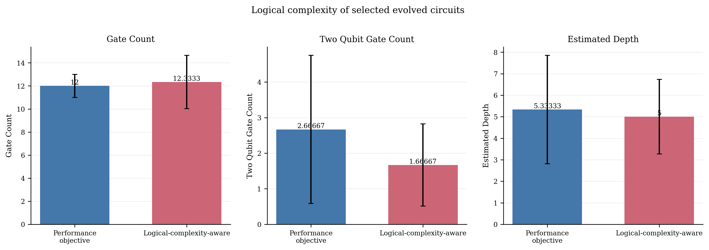
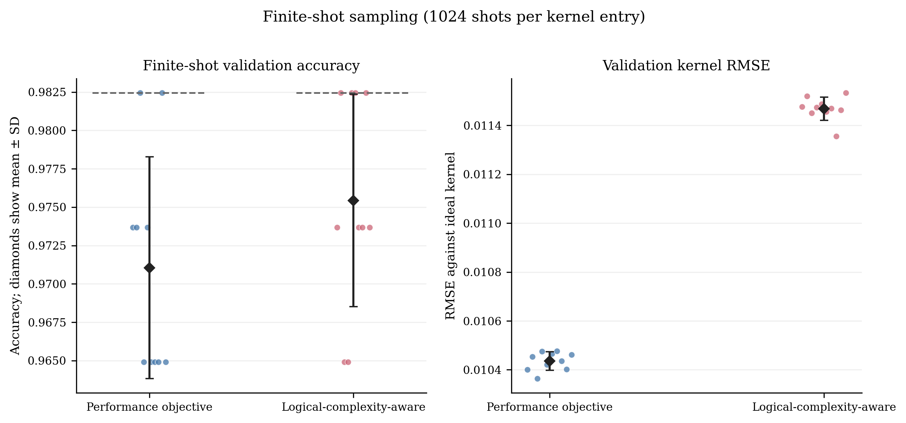
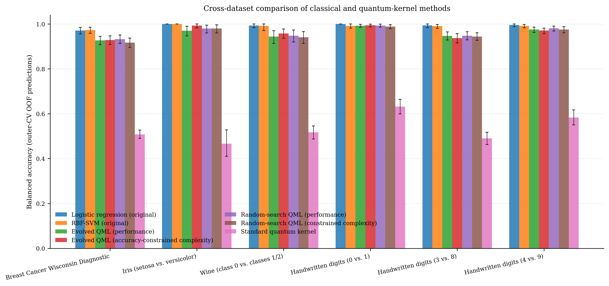
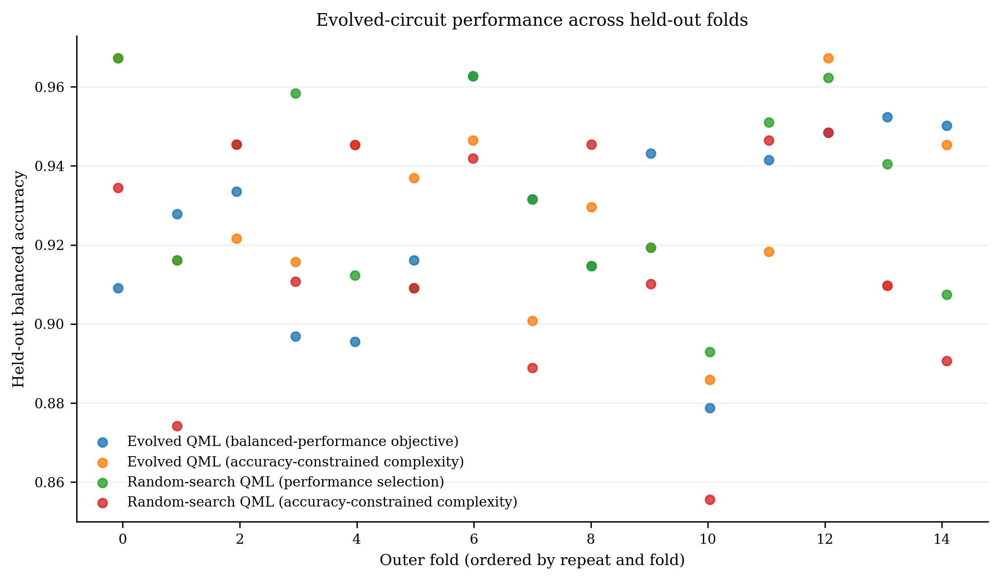

# Optimization of Quantum Circuit Designs Using QML

A Python and Qiskit project that uses evolutionary search to optimize four-qubit quantum kernel circuits for binary classification. The study compares genetic algorithms, random search, and classical ML baselines across six datasets. This project:

- Searches circuit structures with performance-focused and complexity-aware genetic algorithms.
- Compares both genetic algorithm objectives with budget-matched random search.
- Evaluates six binary classification tasks using repeated stratified five-fold cross-validation with three repeats.
- Records selected circuit genomes, gate counts, estimated depth, metrics, and figures.
- Includes separate finite-shot sampling and synthetic-noise experiments.

## Setup and Run

Requires Python 3.10 or newer.

```bash
python -m pip install -r requirements.txt
```

Run the full workflow:

```bash
python main.py
```

Check dependencies and syntax without running experiments:

```bash
python main.py --check
```

Export diagrams and audit tables from circuits already saved in a run:

```bash
python designs.py
```

## Methodology/Workflow

1. Preprocess the data using standardization and PCA where applicable.
2. Encode four input features into a four-qubit circuit.
3. Build a fidelity quantum kernel and train an SVM with the precomputed kernel.
4. Search circuit structures using genetic algorithms and random search.
5. Evaluate selected circuits across repeated cross-validation folds and compare them with classical baselines.
6. Analyse circuit complexity and run separate finite-shot and synthetic-noise experiments.

A complete repeated-CV run saves 360 fold-selected circuit genomes: six datasets, 15 outer folds per dataset, and four search methods. This is the number of selected circuits saved for evaluation, not the total number of temporary candidates tested during search.

## Results

| Result | Finding |
|---|---|
| Balanced accuracy | Evolved quantum models achieved approximately 92.8% to 99.4% across the six tasks using held-out cross-validation predictions. |
| Average balanced accuracy | The complexity-aware genetic algorithm averaged about 0.964, compared with about 0.958 for complexity-aware random search. |
| Circuit complexity | The complexity-aware genetic algorithm averaged about 9.9 total gates and 0.93 two-qubit gates, compared with about 12.6 total gates and 3.31 two-qubit gates for the performance-focused genetic algorithm. |
| Classical baselines | Classical models generally achieved higher balanced accuracy, averaging about 0.972 to 0.977 with four PCA features and about 0.990 to 0.992 with original features. |
| ZZ-inspired kernel baseline | Its balanced accuracy ranged from about 0.467 to 0.631 in this experiment. This result applies to the tested implementation, not to all quantum kernels. |

The largest observed reduction in mean two-qubit gate count versus budget-matched random search was 94.1% on one task. This reduction was not statistically significant after multiple-comparison correction, so it should not be interpreted as a general improvement across all datasets.

## Figures

The examples below refer to the saved run `run_20261010_191938_e4090006`. The image links work when that run is present under `results/runs/`.

### Held-out classification performance



### Validation versus test performance



### Evolutionary search progress



### Circuit complexity



### Finite-shot sampling



### Comparison across six tasks



### Fold-level performance



## Project Files

- `main.py`: starts the workflow and records each run.
- `quantum_core.py`: shared settings, data preparation, and circuit and kernel operations.
- `optimizer.py`: genetic search and kernel evaluation, including synthetic-noise simulation.
- `research.py`: cross-validation, baselines, statistical comparisons, and figure generation.
- `designs.py`: exports diagrams and audit tables from saved circuits.
- `requirements.txt`: Python dependencies.

## Limitations

- The classical baselines generally performed better than the evolved quantum models. 
- Corrected statistical tests did not establish a "consistent" advantage across all tasks. 
- The study does not demonstrate quantum advantage.
